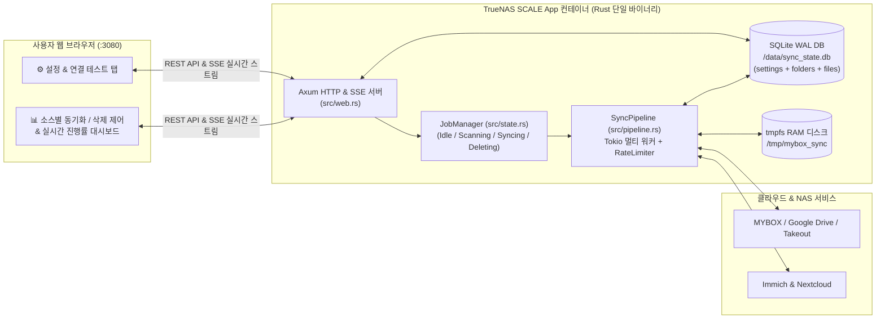

# TrueNAS SCALE 웹 앱 컨테이너: 멀티 클라우드(MYBOX · Google) to NAS(Immich · Nextcloud) 이주 및 사후 삭제 엔진 설계 명세서 (Design Spec)

- **최종 업데이트**: 2026-11-09
- **프로젝트 경로**: `C:\Users\dbstn\.gemini\antigravity\scratch\mybox-immich-sync`
- **언어 및 기술 스택**: **Rust (Edition 2021)** — `axum` (Web API & SSE), `tokio` (비동기 런타임 & 백그라운드 잡), `reqwest`, `sqlx` (SQLite WAL), `sha1`, `zip`, `serde`, `clap`
- **배포 형태**: **TrueNAS SCALE Custom App 컨테이너 (내장 Web UI 대시보드 제공, 포트 `3080`)**
  - 평소에는 웹 브라우저로 접속해 설정 입력, 연결 테스트, 소스별 동기화/일괄 삭제 버튼 클릭 및 실시간 진행률 모니터링을 수행하고, 이주가 끝난 뒤 사용하지 않을 때는 TrueNAS 앱 관리 화면에서 컨테이너를 내려둘(Stop) 수 있는 구조.

---

## 1. 핵심 요구사항 및 설계 원칙

1. **사용자 친화적인 TrueNAS Web UI 앱 컨테이너 (`axum` + 단일 바이너리 내장 UI)**:
   - 별도의 프론트엔드 컨테이너 없이 Rust 바이너리 내부에 반응형 모던 웹 대시보드(`index.html`)를 내장하여 컨테이너 1개(포트 `3080`)만 띄우면 즉시 웹 UI에 접속할 수 있다.
   - **이중 설정 주입 지원**: TrueNAS 앱 배포 시 입력한 환경변수(`MYBOX_PAT`, `IMMICH_URL` 등)를 기본값으로 자동 로드하며, 웹 UI의 **[⚙️ 연결 설정]** 화면에서도 토큰과 주소를 직접 입력·수정하여 SQLite `settings` 테이블에 영구 저장할 수 있다.
   - **[🔌 연결 테스트] 기능**: 동기화를 시작하기 전에 MYBOX, Immich, Nextcloud 각각의 주소와 API 토큰이 유효한지 실시간으로 테스트하고 결과를 즉시 화면에 표시한다.
2. **명시적인 웹 제어 & 실시간 진행률 스트리밍 (SSE)**:
   - 컨테이너가 켜진다고 무조건 작업을 시작하지 않고 **`Idle`(대기 상태, CPU 점유율 0%)**로 시작한다.
   - 사용자가 웹 UI에서 입력 소스(`네이버 MYBOX`, `Google Drive`, `Google Takeout`)를 선택하고 **`[▶️ 스캔 및 동기화 시작]`**, **`[⏸️ 안전 일시정지]`**, **`[🗑️ 완료 항목 원격 삭제]`** 버튼을 명시적으로 클릭할 때만 백그라운드 `tokio` 워커가 구동된다.
   - **Server-Sent Events (`GET /api/events`)**를 통해 새로고침 없이 실시간 진행률(%), 초당 처리 속도, 남은 예상 시간(ETA), Immich/Nextcloud 분류별 완료 건수 및 실시간 로그를 브라우저에 스트리밍한다.
3. **양방향 플러그인 추상화 (`SourceProvider` → `TargetRouter` → `TargetProvider`)**:
   - **입력부(`SourceProvider` trait)**: `MyboxProvider`, `GoogleDriveProvider` (서버 `sha1Checksum` 무다운로드 중복 스킵 포함), `GoogleTakeoutProvider`
   - **라우터(`TargetRouter`)**: 사진·동영상은 `ImmichTarget`으로, 일반 문서·파일은 원본 폴더 경로를 보존하여 `NextcloudTarget`으로 자동 라우팅
   - **출력부(`TargetProvider`)**: `ImmichTarget` (SHA-1 중복 사전 검사 및 업로드), `NextcloudTarget` (WebDAV `MKCOL` 폴더 생성 + `PUT` + `X-OC-MTime` 원본 수정일 보존)
4. **TrueNAS SCALE (ZFS) 최적화 및 SQLite(`WAL`) 체크포인트**:
   - 임시 다운로드 경로(`/tmp/mybox_sync`)는 컨테이너 RAM 디스크(`tmpfs`)에 마운트하고 Rust RAII(`TempFileGuard`) 패턴을 적용하여 ZFS 디스크 쓰기(CoW) 마모와 잔여 임시 파일을 원천 방지한다.
   - 모든 설정과 파일별 체크포인트 상태는 `/data/sync_state.db` 단 하나의 볼륨에 영구 보관되므로, TrueNAS에서 앱을 꺼두었다가(Stop) 몇 달 뒤 다시 켜도(Start) 이전 상태가 100% 그대로 유지된다.

---

## 2. 시스템 아키텍처 및 디렉터리 구조



```text
mybox-immich-sync/
├── Cargo.toml
├── Dockerfile                 # Multi-stage Rust build -> 초경량 단일 바이너리 웹 앱 컨테이너
├── docker-compose.yml         # TrueNAS SCALE Custom App YAML (포트 3080 + /data 볼륨 + tmpfs)
├── .env.example
├── README.md
├── src/
│   ├── lib.rs                 # 모듈 선언 및 외부 노출
│   ├── main.rs                # 엔트리포인트 (기본값: 웹 서버 기동, CLI 서브커맨드도 호환 지원)
│   ├── config.rs              # 환경변수 및 SQLite settings 테이블 통합 설정 구조체
│   ├── db.rs                  # sqlx (SQLite WAL) 체크포인트 & 앱 설정(settings) DB 매니저
│   ├── limiter.rs             # Token-Bucket Rate Limiter & 429/5xx 지수 백오프 재시도
│   ├── router.rs              # 확장자 기반 TargetRouter (Immich vs Nextcloud)
│   ├── state.rs               # JobManager (백그라운드 작업 생명주기, 취소 토큰, SSE 브로드캐스트 채널)
│   ├── web.rs                 # Axum REST API 라우터, 연결 테스터, SSE 핸들러
│   ├── ui.html                # 바이너리에 내장되는 반응형 대시보드 프론트엔드 (HTML/CSS/JS)
│   ├── pipeline.rs            # tokio 멀티 워커 파이프라인 (scan / sync / delete + 실시간 이벤트 발행)
│   ├── sources/
│   │   ├── mod.rs             # SourceProvider trait, RemoteFile, TempFileGuard (RAII)
│   │   ├── mybox.rs           # 네이버 MYBOX Open API 플러그인 (연결 테스트 포함)
│   │   ├── gdrive.rs          # Google Drive API v3 플러그인 (서버 SHA-1 사전 체크 포함)
│   │   └── takeout.rs         # Google Takeout ZIP + JSON 메타데이터 복원 플러그인
│   └── targets/
│       ├── mod.rs             # TargetProvider 모델
│       ├── immich.rs          # 셀프호스팅 Immich REST API 클라이언트 (연결 테스트 포함)
│       └── nextcloud.rs       # 셀프호스팅 Nextcloud WebDAV 클라이언트 (연결 테스트 포함)
└── tests/
    ├── db_test.rs
    ├── router_limiter_test.rs
    ├── pipeline_integration_test.rs
    └── web_api_test.rs
```

---

## 3. SQLite 데이터베이스 스키마 (`/data/sync_state.db`)

### 3.1 `settings` 테이블 (웹 UI 설정 영구 저장)
TrueNAS 앱 배포 시 환경변수로 초기값을 주입할 수 있으며, 웹 UI에서 수정 저장 시 `settings` 테이블 값이 우선 적용된다.

| 컬럼명 | 타입 | 설명 |
|---|---|---|
| `key` | `TEXT PRIMARY KEY` | 설정 키 (`mybox_pat`, `immich_url`, `immich_api_key`, `nextcloud_url`, `nextcloud_user`, `nextcloud_app_password`, `nextcloud_base_dir`, `concurrency`, `rate_limit_rps` 등) |
| `value` | `TEXT NOT NULL` | 설정 값 |
| `updated_at` | `TEXT NOT NULL` | ISO-8601 갱신 시각 |

### 3.2 `folders` 테이블 (소스별 폴더 트리 탐색 체크포인트)
- 복합 기본키: `PRIMARY KEY (source_type, folder_id)`
- 컬럼: `source_type`, `folder_id`, `path`, `last_cursor`, `scan_status` (`PENDING` | `SCANNED` | `FAILED`), `updated_at`

### 3.3 `files` 테이블 (파일별 라우팅, 동기화 및 삭제 체크포인트)
- 복합 기본키: `PRIMARY KEY (source_type, resource_id)`
- 컬럼: `source_type`, `resource_id`, `name`, `parent_path`, `size`, `created_time`, `modified_time`, `target_type` (`immich` | `nextcloud`), `sha1_hash`, `remote_target_id`, `sync_result` (`created` | `duplicate`), `status` (`PENDING` → `UPLOADED` → `DELETED` / `FAILED`), `retry_count`, `error_msg`, `updated_at`

---

## 4. Web UI 및 REST API 상세 규격 (`src/web.rs`)

### 4.1 REST & SSE 엔드포인트 목록
| 메서드 & 경로 | 설명 |
|---|---|
| `GET /` | 내장된 반응형 웹 대시보드(`ui.html`) 렌더링 |
| `GET /api/settings` | 현재 적용 중인 설정 조회 (토큰/비밀번호는 마스킹 표시 여부 포함) |
| `PUT /api/settings` | 웹 UI에서 입력한 토큰·서버 주소·워커 수 설정을 SQLite `settings` 테이블에 즉시 저장 |
| `POST /api/connections/test` | 현재(또는 입력 중인) 설정으로 MYBOX 용량 조회, Immich 서버 핑, Nextcloud WebDAV 인증 테스트를 수행하고 각 서비스별 성공/실패 및 상세 메시지 반환 |
| `GET /api/status?source={source}` | 현재 백그라운드 작업 상태(`Idle`, `Scanning`, `Syncing`, `Deleting`, `Stopping`), 실시간 진행 카운터, 타겟별(Immich/Nextcloud) 통계, 최근 실패 파일 목록 반환 |
| `POST /api/jobs/start` | Body: `{"source": "mybox", "mode": "auto" \| "scan" \| "sync" \| "delete", "dry_run": false}` — 백그라운드 작업 시작 (이미 실행 중이면 `409 Conflict` 반환) |
| `POST /api/jobs/stop` | 현재 실행 중인 백그라운드 작업에 안전 정지 신호 전송 (진행 중인 파일까지만 마치고 체크포인트 저장 후 `Idle` 전환) |
| `POST /api/jobs/retry-failed` | 선택한 소스의 `FAILED` 상태 항목들을 `PENDING`(`retry_count = 0`)으로 초기화 |
| `GET /api/events` | **SSE(Server-Sent Events)** 실시간 스트림: 0.5초 주기로 진행률 스냅샷과 실시간 작업 로그 이벤트를 브라우저로 푸시 |

### 4.2 Web UI 화면 구성 (`src/ui.html`)
1. **상단 헤더 & 작업 상태 배지**:
   - 현재 앱 상태(`⚪ 대기 중 (Idle)` / `🟢 MYBOX 동기화 진행 중...` / `🟠 안전 정지 중...`) 표시
2. **소스 선택 탭**:
   - `[📦 네이버 MYBOX]` / `[☁️ Google Drive]` / `[🗂️ Google Takeout]`
3. **실시간 진행률 & 통계 카드 섹션**:
   - 전체 진행률 프로그레스 바 (%) + 처리 속도(파일/초) + 현재 처리 중인 파일명 표시
   - **4대 요약 카드**:
     1. **스캔/대기 중 (`PENDING`)**: 발견된 폴더 및 대기 파일 수 / 총 용량
     2. **📸 Immich 이주 완료 (`UPLOADED - immich`)**: 신규 업로드 건수 vs 중복 스킵 건수
     3. **📁 Nextcloud 이주 완료 (`UPLOADED - nextcloud`)**: 폴더 구조 유지 업로드 건수 및 용량
     4. **🗑️ 원격 삭제 완료 (`DELETED`) & ⚠️ 실패 (`FAILED`)**: 휴지통 이동 완료 건수 및 오류 재시도 버튼
4. **작업 컨트롤 패널 (명시적 액션 버튼)**:
   - `[▶️ 원클릭 스캔 & 동기화 시작]` / `[🔍 스캔만 실행]` / `[⏸️ 일시정지 (안전 중단)]`
   - `[🧪 원격 삭제 시뮬레이션 (Dry-Run)]` / `[🗑️ 완료 항목 원격 삭제 (휴지통 이동)]` (확인 모달 포함)
5. **접이식 [⚙️ 연결 및 성능 설정] 패널**:
   - `MYBOX 개인 액세스 토큰`, `Immich URL & API Key`, `Nextcloud URL & 아이디 & 앱 비밀번호 & 기본 폴더`, `동시 워커 수(CONCURRENCY)`, `초당 요청 제한(RPS)` 입력 폼
   - `[🔌 전체 연결 테스트]` 버튼 및 `[💾 설정 저장]` 버튼
6. **실시간 로그 콘솔**:
   - SSE로 수신되는 최근 100줄의 작업 로그 및 오류 내역 실시간 표시

---

## 5. TrueNAS SCALE 배포 구성 (`docker-compose.yml`)

TrueNAS SCALE의 `Apps -> Discover Apps -> Custom App -> Install via YAML` 또는 SSH/Dockge에서 바로 사용할 수 있는 구성이다.

```yaml
services:
  mybox-sync:
    build: .
    container_name: mybox-immich-sync
    ports:
      - "3080:3080"
    environment:
      - PORT=3080
      - TZ=Asia/Seoul
      # 아래 환경변수는 선택사항 (비워두어도 웹 UI 접속 후 [설정] 화면에서 직접 입력 및 저장 가능)
      - MYBOX_PAT=${MYBOX_PAT:-}
      - IMMICH_URL=${IMMICH_URL:-}
      - IMMICH_API_KEY=${IMMICH_API_KEY:-}
      - NEXTCLOUD_URL=${NEXTCLOUD_URL:-}
      - NEXTCLOUD_USER=${NEXTCLOUD_USER:-}
      - NEXTCLOUD_APP_PASSWORD=${NEXTCLOUD_APP_PASSWORD:-}
    volumes:
      # TrueNAS SCALE 예시: /mnt/<Pool이름>/apps/mybox-sync/data:/data
      - ./data:/data
    tmpfs:
      # ZFS 디스크 쓰기(CoW) 및 스냅샷 부풀림 방지를 위해 임시 다운로드는 RAM(tmpfs)에서 처리 후 즉시 삭제
      - /tmp/mybox_sync:size=1G,mode=1777
    restart: unless-stopped
```
